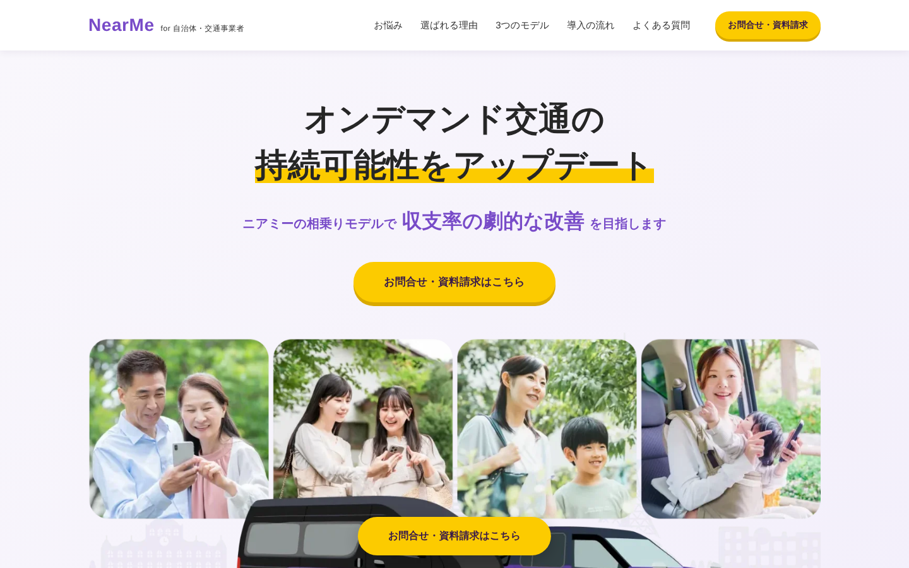
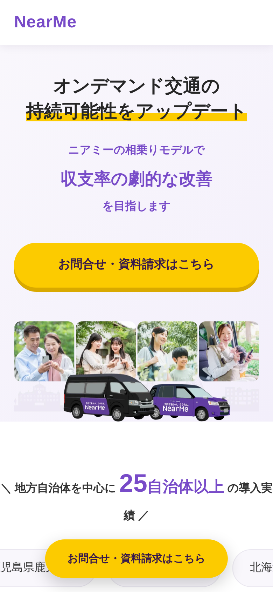

# NearMe Partners LP（練習用コーディング）

自治体・交通事業者向けに、NearMe（ニアミー）のオンデマンド交通「相乗り」モデルを紹介するランディングページを、HTML / CSS で模写・再構成した練習用サイトです。
G'sアカデミーの課題として制作しました。

> **Note**
> 本リポジトリは学習目的の練習用サイトです。公式ページ（https://corp.nearme.jp/partners/ ）との重複を避けるため、`noindex` と `canonical` を設定しています。



## ページ構成

| セクション | 内容 |
| --- | --- |
| ヘッダー | ロゴ、アンカーナビ、お問合せボタン（固定表示） |
| メインビジュアル | キャッチコピーとCTA。PC / スマホで画像を切り替え（`<picture>`） |
| 導入実績 | 25自治体以上の導入先を横に流れるマーキーで表示 |
| 導入事例（CASE） | 鹿児島市・北秋田市・芽室町の3事例 |
| お悩み | 自治体が抱える課題と解決の提示 |
| 選ばれる理由（POINT） | 収支率改善／柔軟なサービス設計／ワンストップ支援 |
| 3つのモデル（MODEL） | 相乗り・乗合・日本版／公共ライドシェア、カスタマイズ機能 |
| 中間CTA | お問合せ・資料請求への導線 |
| 導入の流れ（FLOW） | 導入設計 → サービス実装 → 運営・改善 |
| よくある質問（FAQ） | `<details>` / `<summary>` による開閉式 |
| フッター・追従ボタン | 画面下に追従するお問合せボタン |

## 使用技術

- HTML5（セマンティックタグ：`header` / `main` / `section` / `article` / `footer`）
- CSS3（Flexbox / Grid、CSSアニメーションによるマーキー、`scroll-behavior: smooth`）
- Google Fonts（Noto Sans JP / Lato）
- JavaScript は不使用（FAQの開閉も HTML の `details` 要素で実装）

## レスポンシブ対応

- ブレイクポイント：`960px` / `768px`
- スマホ表示ではヘッダーのボタンを隠し、画面下の追従ボタンに集約
- メインビジュアルは画面幅に応じて PC 用 / スマホ用の画像を出し分け

| PC | スマホ |
| --- | --- |
|  |  |

全体のキャプチャは [`capture/nearme_lp_pc_full.jpg`](capture/nearme_lp_pc_full.jpg) を参照してください。

## ディレクトリ構成

```
nearme-partners-lp/
├── index.html        # ページ本体
├── css/
│   └── style.css     # スタイル（カラー定義・レスポンシブ含む）
├── img/              # 画像素材（webp / jpg / png）
└── capture/          # 完成イメージのスクリーンショット
```

## 表示方法

ビルド不要です。リポジトリをクローンして `index.html` をブラウザで開いてください。

```bash
git clone https://github.com/ikariblog/nearme-partners-lp.git
cd nearme-partners-lp
open index.html   # Windows の場合は start index.html
```

## カラー

| 用途 | カラー |
| --- | --- |
| メイン（紫） | `#784bc8` |
| 濃い紫 | `#37194b` |
| アクセント（黄） | `#fccb00` |
| 背景（薄紫） | `#f9f7fc` / `#f3effb` |
| 本文 | `#333333` |

## 注意事項

- 掲載している文章・事例・画像は参考サイトをもとにした学習用のものです。
- お問合せボタンのリンク先（Googleフォーム）は練習用に設定したものです。
